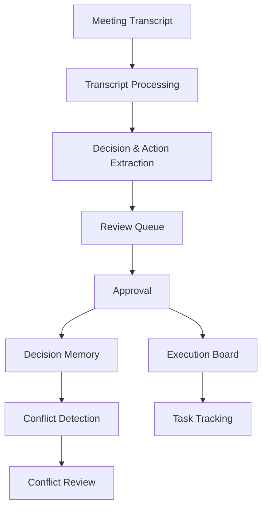

# Ledgerline

<p align="center">
  <strong>Decisions that stick. Contradictions that don't slip through.</strong>
</p>

<p align="center">
  An AI-powered decision intelligence platform that transforms meeting conversations into structured decisions, actionable tasks, and a searchable memory of team commitments.
</p>

---

## 🚀 Overview

Teams make important decisions every day, but those decisions often get buried in meeting notes, forgotten across conversations, or contradicted in future discussions.

**Ledgerline** solves this by creating a persistent decision memory for teams. It analyzes meeting transcripts, extracts key decisions and action items, tracks ownership and deadlines, and detects conflicts between new proposals and previously approved decisions.

Ledgerline helps teams move beyond simply recording meetings — toward remembering decisions, maintaining consistency, and ensuring accountability.

---

## 💡 The Problem

- Important decisions get lost in long meeting transcripts.
- Teams repeatedly discuss topics that have already been resolved.
- New proposals may contradict previously approved decisions.
- Action items lack clear ownership or deadlines.
- There is no reliable connection between what teams decide and what they actually execute.

## ✨ The Solution

Ledgerline converts unstructured meeting conversations into structured, searchable, and actionable organizational knowledge.

By combining AI-powered extraction with decision memory and conflict detection, it helps teams preserve context, review commitments, and identify inconsistencies before they lead to confusion.

---

## 🔥 Key Features

| Feature | Description |
|---|---|
| 📝 Meeting Intelligence | Extract decisions and action items from meeting transcripts. |
| 🧠 Decision Memory | Store and retrieve previously approved decisions. |
| ⚠️ Conflict Detection | Identify new proposals that contradict existing decisions. |
| 🔍 Contextual Comparison | Compare new decisions with historical context. |
| ✅ Review Queue | Review, verify, and approve extracted information. |
| 📋 Execution Board | Track tasks, owners, deadlines, and status. |
| 📊 Dashboard | Get a centralized overview of decisions and commitments. |
| 🤖 AI-Assisted Processing | Automate the conversion of conversations into structured information. |

---

## ⚙️ How It Works



1. **Input** – Upload or provide a meeting transcript.
2. **Extract** – Identify decisions, commitments, action items, owners, and deadlines.
3. **Review** – Verify extracted information before approving it.
4. **Remember** – Save approved decisions into persistent decision memory.
5. **Detect** – Compare future proposals against existing decisions.
6. **Act** – Track approved action items through the execution board.

---

## 🖥️ Product Modules

### Dashboard
A centralized overview of team decisions, pending reviews, open action items, and progress.

### Decision Memory
A structured record of approved decisions that preserves context and makes previous commitments easier to retrieve.

### Conflict Detection
Identifies potential contradictions between new proposals and existing decisions, helping teams recognize inconsistencies early.

### Review Queue
Provides a human review step to validate extracted decisions before they become part of the team's decision history.

### Execution Board
Turns meeting commitments into trackable tasks with ownership, deadlines, and progress status.

---

## 🏗️ Architecture

Ledgerline follows a frontend–backend architecture:

- **Frontend** – Interactive dashboard and decision management interface.
- **Backend API** – Handles processing, business logic, data operations, and integrations.
- **AI Processing Layer** – Extracts structured decisions and action items from meeting content.
- **Decision Memory** – Stores approved decisions for future retrieval and comparison.
- **Conflict Detection Engine** – Checks new proposals against historical decisions.
- **Task Management Layer** – Organizes commitments into trackable tasks.

---

## 🛠️ Tech Stack

| Layer | Technology |
|---|---|
| Frontend | Web-based UI |
| Backend | FastAPI |
| API | REST |
| AI | AI-powered transcript extraction |
| Data Processing | Transcript parsing & structured extraction |
| Storage | Structured data storage |
| Documentation | FastAPI Swagger UI |

> The repository's implementation may include additional technologies and integrations. Refer to the source code and configuration files for the complete stack.

---

## 🎯 Use Cases

- **Project Teams** — Maintain alignment on project scope, requirements, and deadlines.
- **Product Teams** — Preserve feature decisions and prevent conflicting requirements.
- **Startup Teams** — Track discussions, ownership, and execution.
- **Remote Teams** — Maintain organizational memory across distributed meetings.
- **Management Teams** — Review decisions and monitor follow-through.

---

## 🌟 What Makes Ledgerline Different?

Traditional meeting tools focus on recording, transcribing, or summarizing conversations.

Ledgerline focuses on what happens **after the conversation**.

It connects:

**Conversation → Decision → Memory → Conflict Detection → Execution**

Rather than treating every meeting as an isolated event, Ledgerline creates continuity between past decisions and future actions.

---

## 🔐 Reliability & Human Review

AI-generated decisions should not automatically become unquestioned organizational truth.

Ledgerline incorporates a review workflow that allows extracted information to be checked and approved. This helps maintain decision quality while reducing manual effort.

---

## 🚧 Future Enhancements

- Real-time meeting integrations
- Calendar and conferencing platform integrations
- Decision timeline and history visualization
- Team collaboration and role-based access
- Notifications for unresolved conflicts
- Advanced analytics for decision and task completion
- Improved semantic conflict detection

---

## ▶️ Getting Started

Clone the repository:

```bash
git clone https://github.com/arpita7819/LederLine.git
cd LederLine
```

Follow the backend and frontend setup instructions in the repository to install dependencies, configure environment variables, and start the application.

---

## 📌 Project Status

Ledgerline is an actively developed project. Some features, integrations, and workflows may evolve as development progresses.

---

## 👩‍💻 Team / Developer

Built as an AI-powered productivity and decision intelligence project.

**GitHub:** [@arpita7819](https://github.com/arpita7819)

---

## 📄 License

This project is currently available for review and development. Licensing details can be added when a license is selected.

---

<p align="center">
  <strong>Ledgerline</strong><br/>
  Decisions that stick. Contradictions that don't slip through.
</p>

